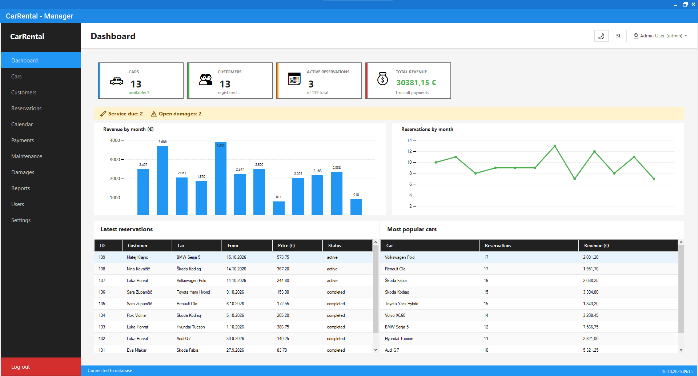
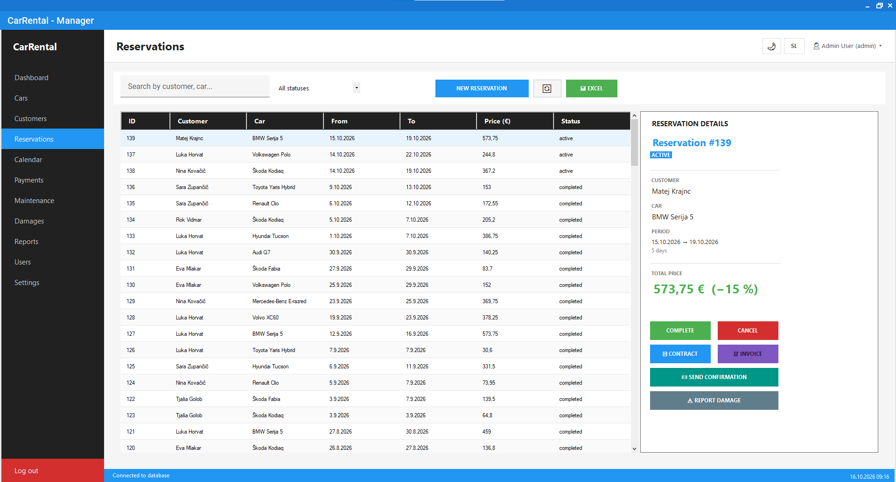
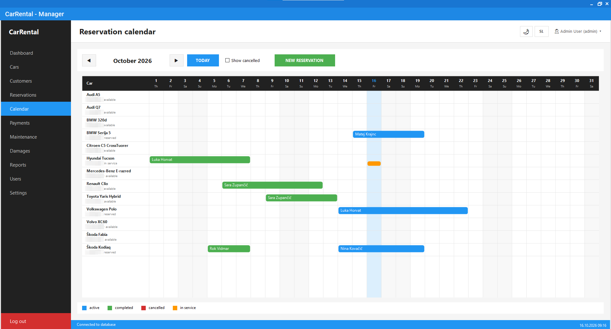
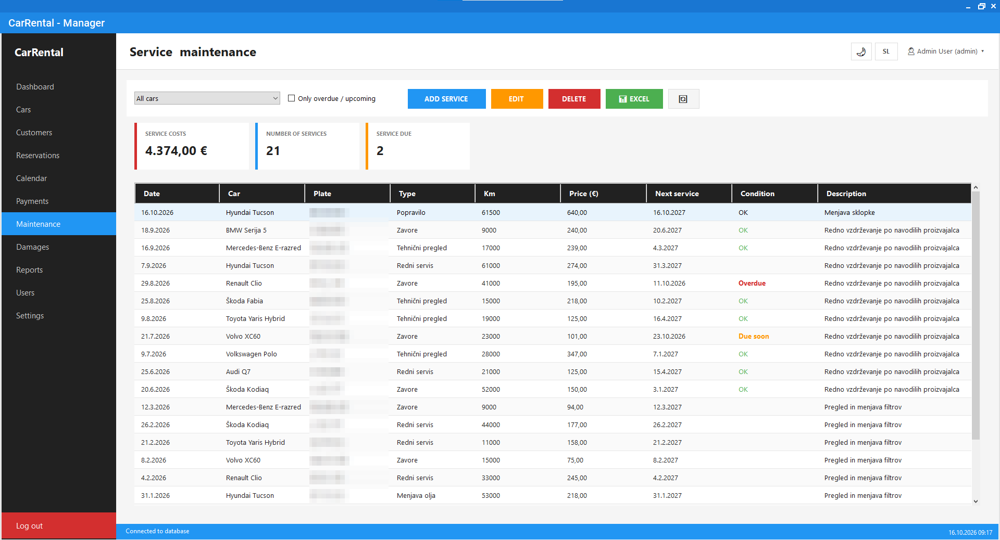
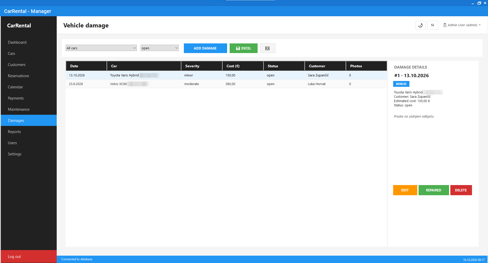
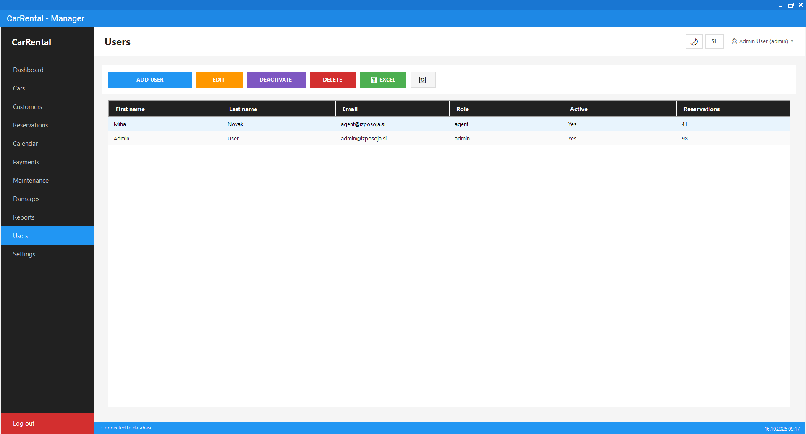
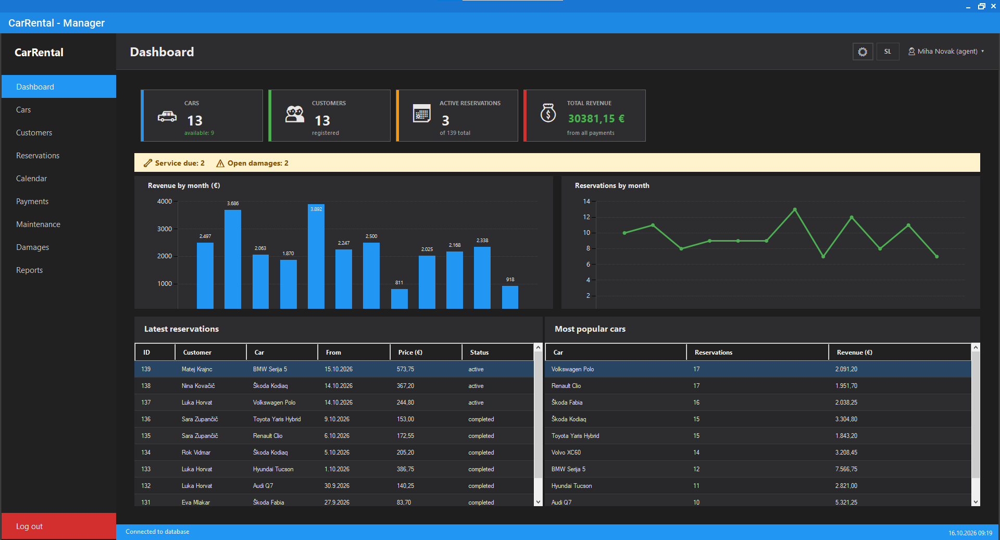

# 🚗 CarRental

> A desktop application for managing car rental operations, built with C# Windows Forms and SQLite.


## 📋 About

CarRental is a Windows Forms desktop application for managing a car rental business – vehicle inventory, customer records, reservations and payments.

It was first developed as a school project for the **Programming 1** course (v1.0). After the course I kept working on it at home and released a much bigger second version (v2.0).

| Version | What it is |
|---|---|
| **[v1.0 – School project](https://github.com/kevinm124/CarRental/releases/tag/v1.0)** | Built for the Programming 1 course: cars, customers, reservations, payments and a dashboard |
| **[v2.0 – Home upgrade](https://github.com/kevinm124/CarRental/releases/tag/v2.0)** | Built afterwards at home: PDF documents, Excel export, charts, dark mode, English/Slovenian, user roles, calendar, reports, maintenance, damage reports, loyalty programme and more |

The app can be switched between **English and Slovenian** at any time.

---

## 🎓 v1.0 – School project

The version submitted for the Programming 1 course.

### ✨ Features

- 🔐 **Secure login** with BCrypt password hashing
- 🚙 **Car management** with image uploads and status tracking
- 👥 **Customer registration** with search and filtering
- 📅 **Reservation system** with automatic price calculation
- 💰 **Payment tracking** with real-time statistics
- 📊 **Dashboard** showing business metrics and popular cars
- 🔍 **Search and filtering** across all data tables
- 🎨 **Modern Material Design UI** via MaterialSkin library

### 📸 Screenshots (v1.0)

<table>
  <tr>
    <td align="center">
      
      <br />
      <sub><b>🔐 Login Screen</b></sub>
    </td>
    <td align="center">
      
      <br />
      <sub><b>➕ Add New Car</b></sub>
    </td>
  </tr>
</table>


<p align="center"><sub><b>Dashboard with Statistics</b></sub></p>


<p align="center"><sub><b>Car Management</b></sub></p>


<p align="center"><sub><b>Customers View</b></sub></p>

---

## 🏠 v2.0 – Home upgrade

After the course I added everything from my "future improvements" list – and more.

### ✨ New features

| Feature | Description |
|---|---|
| 🧾 **PDF invoices** | Professional invoices with VAT breakdown, discounts and recorded payments |
| 📄 **Rental contracts** | Printable PDF rental agreement with parties, vehicle details, terms and signature lines |
| 📊 **Excel export** | Every table can be exported to a formatted `.xlsx` file |
| 📈 **Charts** | Revenue and reservations by month on the dashboard and in reports |
| 🌙 **Dark mode** | Switch between light and dark theme with one click |
| 🌍 **English / Slovenian** | The whole UI, messages and PDF documents switch language at runtime |
| ✉️ **Email confirmations** | Reservation confirmations sent to customers via SMTP, optionally with the contract attached |
| 💾 **Backup & restore** | One-click backup of the database and all images to a ZIP file, with an automatic safety copy before restoring |
| 👥 **User roles** | *Admin* (full access) and *Agent* (no deleting, users or settings), user management and password change |
| 📅 **Reservation calendar** | Monthly timeline of all cars with colored booking bars and service days |
| 📑 **Advanced reports** | Any date range: revenue by month, by car (with utilisation), by customer, by category and by payment method – export to PDF or Excel |
| 🔧 **Maintenance tracking** | Service history per car, costs, odometer and next-service reminders (overdue / due soon) |
| ⭐ **Loyalty programme** | Bronze / Silver / Gold levels based on completed rentals, discount applied automatically |
| 📷 **Photo gallery** | Multiple images per car with a selectable main image |
| ⚠️ **Damage reports** | Record and photograph damage between rentals; the app asks about damage when a car is returned |
| 🧪 **Demo data** | One click fills the app with realistic demo data for trying it out |

### 🔧 Other improvements

- Dashboard warning bar: services due, open damages, returns today and overdue returns
- Foreign keys are enforced, so no more orphaned reservations
- The database is always stored next to the executable
- Images are loaded without locking files
- v1.0 databases are upgraded automatically without losing data

### 📸 Screenshots (v2.0)

> All data in these screenshots is generated demo data. License plates are blurred.


<p align="center"><sub><b>Dashboard – charts and warning bar</b></sub></p>


<p align="center"><sub><b>Reservations – loyalty discount, contract, invoice, email and damage reporting</b></sub></p>


<p align="center"><sub><b>Reservation calendar</b></sub></p>


<p align="center"><sub><b>Service & maintenance with next-service reminders</b></sub></p>


<p align="center"><sub><b>Vehicle damage reports</b></sub></p>


<p align="center"><sub><b>User management – admin and agent roles</b></sub></p>


<p align="center"><sub><b>Dark mode, logged in as an agent (admin-only pages hidden)</b></sub></p>

---

## 🛠️ Tech Stack

| Technology | Purpose |
|------------|---------|
| **C#** | Programming language |
| **.NET Framework 4.8** | Runtime |
| **Windows Forms** | GUI framework |
| **SQLite** | Local database |
| **MaterialSkin.2** | Modern UI styling |
| **BCrypt.Net-Next** | Password hashing |
| **ClosedXML** | Excel export *(v2.0)* |
| **PDFsharp / MigraDoc** | PDF invoices, contracts and reports *(v2.0)* |
| **DataVisualization Charts** | Charts *(v2.0)* |

## 📁 Project Structure

```
CarRental/
├── Obrazci/          # Windows Forms (screens and dialogs)
├── Baza/             # Database connection, schema and migrations
│   └── PovezavaBaze.cs
├── Modeli/           # Data models
├── Pomocniki/        # Helpers – settings, theme, translations, PDF,
│                     #           Excel, email, backup, loyalty, demo data
├── Slike/            # Images (cars, damages)
└── screenshots/      # README screenshots
```

## 🗄️ Database Schema

The SQLite database (`izposoja.db`) is created automatically on first launch.

**v1.0 tables**
- `kategorije` — Car categories (Economy, SUV, Luxury)
- `avtomobili` — Cars with details and image paths
- `stranke` — Customers
- `zaposleni` — Employees (login and roles)
- `rezervacije` — Reservations linking customers and cars
- `placila` — Payments linked to reservations

**Added in v2.0**
- `nastavitve` — App settings (theme, language, company, email, loyalty)
- `avtomobili_slike` — Photo gallery per car
- `servisi` — Service and maintenance history
- `poskodbe`, `poskodbe_slike` — Damage reports and their photos

## 🚀 Getting Started

### Prerequisites

- Visual Studio 2022 (Community Edition is fine)
- .NET Framework 4.8
- Windows 10/11

### Installation

1. **Clone the repository**
   ```bash
   git clone https://github.com/kevinm124/CarRental.git
   ```

2. **Open the solution**
   - Open `CarRental.sln` in Visual Studio 2022

3. **Build and run**
   - Press `F5` – NuGet packages are restored automatically

### Default Login

- **Admin:** `admin@izposoja.si` / `admin123`

**Demo data:** in *Settings → General → Add demo data* the app fills the database with cars, customers, a year of reservations, payments, services and damage reports, and creates an agent account (`agent@izposoja.si` / `agent123`).

## 🎓 Learning Outcomes

Through this project, I gained hands-on experience with:

- Object-oriented programming in C#
- Windows Forms development and event-driven programming
- SQLite database design, SQL queries and database migrations
- File system operations (image handling, ZIP backups)
- Password security with BCrypt hashing
- Third-party library integration (MaterialSkin, ClosedXML, PDFsharp)
- Generating PDF documents and Excel files
- Multi-language and theme support in desktop apps
- Working with AI tools for development assistance

## 📝 License

This project is licensed under the MIT License — see the [LICENSE](LICENSE.txt) file for details.

## 👤 Author

**Kevin Markoja**

- School: Ekonomska šola Murska Sobota, Višja strokovna šola
- Program: Informatika in računalništvo
- Course: Programming 1

## 🙏 Acknowledgments

- **Claude AI** — For assistance with the upgrades and advanced features
- **MaterialSkin** by leocb — For the modern UI library
- **System.Data.SQLite** — For the database engine
- **ClosedXML** and **PDFsharp / MigraDoc** — For Excel and PDF generation

> Code identifiers are in Slovenian, as required by the original school project.

---

⭐ If you found this project helpful or interesting, consider giving it a star!
